<p align="center">
  
</p>

<h1 align="center">Barebone</h1>

<p align="center"><b>The basics are all you need.</b></p>

<p align="center">A small macOS app for the <a href="https://opencode.ai">opencode</a>, <a href="https://cline.bot">Cline</a>, <a href="https://commandcode.ai">Command Code</a>, Codex and Claude Code coding agents: projects, chats, skills, and a built-in browser they can drive. Nothing else.</p>

<p align="center"><a href="https://github.com/AtheerAPeter/barebone/releases/latest"><b>Download for macOS (Apple Silicon)</b></a></p>

---

Barebone has no model providers and no API keys of its own. It starts the CLIs you already have installed, talks to them over the [Agent Client Protocol](https://agentclientprotocol.com) (`opencode acp`, `cline --acp`, `cmd acp`), and shows whatever models they report. Codex and Claude Code have no ACP mode of their own, so the app runs them through the ACP adapters their makers co-maintain, [codex-acp](https://github.com/agentclientprotocol/codex-acp) and [claude-agent-acp](https://github.com/agentclientprotocol/claude-agent-acp). If a model works in your terminal, it works here.

The exceptions are **Command Code API**, **OpenCode API** and **Cline API**. For these the app runs its own small agent, modeled on [pi](https://github.com/earendil-works/pi): four tools (read, bash, edit, write), opencode's Exa web search, and the browser panel. Web search works without a key on Exa's free tier; add your own Exa API key in Settings (⌘,) to use your Exa account. It calls each provider's API directly with the login its CLI already saved: `cmd login`, `opencode auth login` (Zen and Go) or `cline auth` (usage billing and ClinePass). Model lists come from the providers live, so new models show up without an update. The free models of OpenCode and Cline are not listed: both serve them only to their own apps.

You can also add your own providers in Settings (⌘,) under **Providers**: any API that speaks OpenAI Chat Completions, OpenAI Responses or Anthropic Messages. Give it a name, the base URL (such as `https://api.openai.com/v1`), a key if it takes one, extra headers if it needs them, and optionally the model ids to offer. Without model ids, the app lists the ones the provider's `/models` returns. Presets fill in OpenAI, Anthropic, OpenRouter, Google Gemini, DeepSeek, xAI, Groq, Mistral, Ollama and LM Studio. Each provider shows in the model picker under **Custom providers**, and its chats run on the same agent as the API agents above. Output limits and image input come from [models.dev](https://models.dev) for the presets' addresses. Keys are kept in `providers.json`, readable only by you, and the window only sees their last four characters. A local server without a key is sent no auth header. Custom providers have no MCP servers of their own.

Claude Code chats get a few things the other CLIs don't offer. When Claude asks you something (its AskUserQuestion tool), the chat shows the question as a form with its options and a box for your own answer; MCP servers' questions and sign-in pages come up the same way, for every agent that sends them. A subagent shows as one line, with its tool calls and its report folded under it. When a command Claude left running in the background ends, Claude goes on by itself, and the chat shows that turn as working, with Stop. Its process is not stopped while such work may still run, since stopping it would end the work too. Under the composer, a ring shows how full the model's context window is, for every agent that reports it.

Under **Custom instructions** in Settings you can write instructions for every chat on the app's own agent (Custom providers, OpenCode API, Cline API and Command Code API). They go into the system prompt, before the project's `AGENTS.md` or `CLAUDE.md`, and the subagents a chat starts get them too. A chat's system prompt is fixed when it starts, so that every request hits the provider's prompt cache, so a change applies to the chats started after it. Chats on the opencode, Cline, Command Code, Codex and Claude Code CLIs don't get them: those CLIs build their own system prompts, and they only read extra instructions from their own global rule files.

The API agents also get the MCP servers you set up in the matching CLI: OpenCode API reads opencode's `mcp` config, Cline API reads `cline_mcp_settings.json`, and Command Code API reads Command Code's `mcp.json` files and the project's `.mcp.json`. A server that the project's own `opencode.json` sets up or changes comes with the code, so the chat asks before starting it, in every mode. The question says what it runs or connects to, the variables and headers it sets, and the files and variables its config pulls in. A yes is remembered for that exact config and the project files its command runs, and a change to either is asked about again. When a server asks for an OAuth sign-in, the chat offers to open your browser for it. The app keeps that login itself, so you sign in once in the app even if the CLI is already signed in.

A chat can start other chats in its project when you ask it to: write `@chats`, or say so ("do this in three new chats"). The agent is told to do so only on request. Each new chat gets the same agent, model and permissions and works on its own. When it is done it reports back, and the report arrives in the first chat as a new message. Chats can also list the project's running chats and message each other to coordinate. A message to a busy chat joins its turn after the step it is on, so a chat can steer the ones it started. The API agents and Claude Code take it into the running turn; the other CLIs have no way to, so their turn is ended after that step and the message starts the next one. A chat takes at most 20 messages from other chats between your own messages, so two chats cannot keep each other running, and Stop drops the messages still waiting. A chat that another chat started cannot start chats itself, and a chat cannot message one with broader permissions than its own (Ask to Full access, or project-only to unrestricted), except to report back to the chat that started it.

## Keyboard shortcuts

| Shortcut | Action |
|---|---|
| ⌘N | New chat |
| ⌘O | Open project folder |
| ⌃⌘S | Show or hide the sidebar |
| ⌘B | Show or hide the browser |
| Enter / Shift+Enter | Send / new line |

## Install

Open Terminal and run:

```bash
curl -fsSL https://raw.githubusercontent.com/AtheerAPeter/barebone/main/install.sh | bash
```

It downloads the latest release, installs Barebone in Applications and opens it. Run it again any time to update. The app also checks for a new release when it starts and every six hours, and shows **Update to v…** at the bottom of the sidebar. Clicking it runs the same script, which quits the app, installs the new version and opens it. Installing this way skips macOS's "Apple could not verify…" prompt, because only browser downloads get flagged.

Or download the `.dmg` from [Releases](https://github.com/AtheerAPeter/barebone/releases/latest) and drag Barebone to Applications. The app isn't notarized by Apple, so the first launch from a browser download is blocked: click **Done**, then **System Settings → Privacy & Security → Open Anyway** (once).

Apple Silicon only. You also need at least one agent installed and signed in:
- opencode (1 or 2): `curl -fsSL https://opencode.ai/install | bash`, then `opencode auth login`. OpenCode API follows the opencode you have installed: opencode 2 keeps its keys in its database and reads its config in its own order, opencode 1 keeps them in `auth.json`.
- Cline: `npm i -g cline`, then `cline auth`
- Command Code (1.74 or newer): `npm i -g command-code`, then `cmd login`. Command Code API uses the same login; its API access needs a GOAT plan or higher. OpenCode API and Cline API use the opencode and Cline logins above.
- Codex: `npm i -g @openai/codex @agentclientprotocol/codex-acp`, then `codex login` (ChatGPT plan or API key).
- Claude Code: install [Claude Code](https://code.claude.com/docs/en/setup) and `npm i -g @agentclientprotocol/claude-agent-acp`, then `claude auth login`. The adapter runs your own `claude`, so a Claude plan is used the way Anthropic allows: you sign in through Claude Code itself, and the app never sees the login.

The app finds the CLIs through your login shell's `PATH`, the same way your terminal does.

## Build from source

Requires macOS, Node.js 22+ and npm.

```bash
npm install
npm run dev                                     # run in development
npx electron-vite build && npx electron-builder --mac dmg   # build the .app and .dmg into dist/
```

## How it works

- `src/main/agents.ts` runs one ACP connection per agent CLI, maps chats to ACP sessions, and turns session updates into chat items. Command Code's ACP process serves a single folder, so it gets one connection per project.
- `src/main/harness/` is the app's own agent. `commandcode.ts`, `opencode.ts` and `cline.ts` say where each provider's models live and how to sign in, and `custom.ts` does the same for the providers added in Settings; `catalog.ts` keeps their model lists on disk and refreshes them every 10 minutes. `wire.ts` sends models on Anthropic's `/v1/messages` with the Anthropic SDK, and the rest on `/v1/chat/completions` or `/v1/responses` with the OpenAI SDK. Responses requests are sent with `store: false`, so the provider keeps nothing, and a reply's reasoning is sent back encrypted, as the provider returned it. Cline's login is shared with the CLI: when it is about to expire, the app renews it under the CLI's own lock and writes it back, so both keep working. `agent.ts` runs the loop and stores each chat as an append-only JSONL transcript. The system prompt is fixed when a chat starts, the tools are always listed in the same order, and each reply is replayed exactly as the API returned it (thinking signatures, reasoning fields). Every request therefore extends the previous one byte for byte and hits the provider's prompt cache. Claude requests carry cache breakpoints on the tools, the system prompt and the newest message.
- `src/main/browser.ts` owns the browser panel, a `WebContentsView` on a persistent session partition, so cookies and logins are stored on disk.
- `src/main/page-driver.ts` drives a page for agents over the DevTools protocol, with Playwright's in-page script for snapshots and element checks (the approach is adapted from ZCode's browser). `src/preload/page.ts` sends a page's alerts and confirms to the app.
- `src/main/browser-mcp.ts` is an MCP server on `127.0.0.1` (bearer-token protected) that exposes the panel to agents. Opencode, Command Code, Codex and Claude Code receive it through ACP; Cline's ACP mode ignores MCP servers sent by clients, so the app registers it with `cline mcp add`.
- `src/main/chats-mcp.ts` is a second MCP server at the same address (`/chats`) with `start_chat`, `send_message` and `list_chats`. Every agent gets it the same way as the browser's. Chats name themselves by the ID each prompt gives them, and `agents.ts` keeps the messages that wait for a busy chat.
- `src/main/harness/mcp-config.ts` reads each CLI's MCP servers the way that CLI does: file locations, merge order, variable substitution, and servers turned off. `mcp.ts` connects to them with the MCP SDK (stdio, Streamable HTTP, SSE). A chat's first request takes their tools, named `mcp__<server>__<tool>`, into its fixed tool list. `mcp-auth.ts` handles OAuth sign-in through the SDK and keeps the tokens in `mcp-auth.json`, readable only by you.
- `src/main/skills.ts` reads skills from `.claude/skills`, `.opencode/skills`, `.agents/skills`, `.cline/skills`, `.commandcode/skills` and their global equivalents.

Chats, settings and the browser profile are stored in `~/Library/Application Support/Barebone`. The agent sessions themselves are stored by each CLI.

Barebone was called Just Harness up to 1.0.63. On its first start it moves `~/Library/Application Support/Just Harness` to its own folder (`src/main/former-name.ts`), and the install script replaces `Just Harness.app`. Project icons saved in `.just-harness/` are still read; choosing a new one saves it in `.barebone/`.

## Known limitations

- Cline's ACP mode currently ignores reasoning effort (`--thinking`), so there's no effort picker for Cline.
- Command Code API has no compaction. Start a new chat when one gets long.
- An API chat's MCP tools are set when the chat starts. A server you add or sign in to later shows up in the next new chat.
- The app reads only `PATH` from your login shell. Other variables exported in `.zshrc` are not seen by `{env:…}` or `${…}` in MCP configs, or by stdio servers.
- Cline starts a background "hub" process of its own that keeps running after the app quits.
- Apple Silicon only for now, and not notarized (see Install).

## License

[MIT](LICENSE). Bundled third-party code is listed in [THIRD-PARTY-NOTICES.md](THIRD-PARTY-NOTICES.md).
